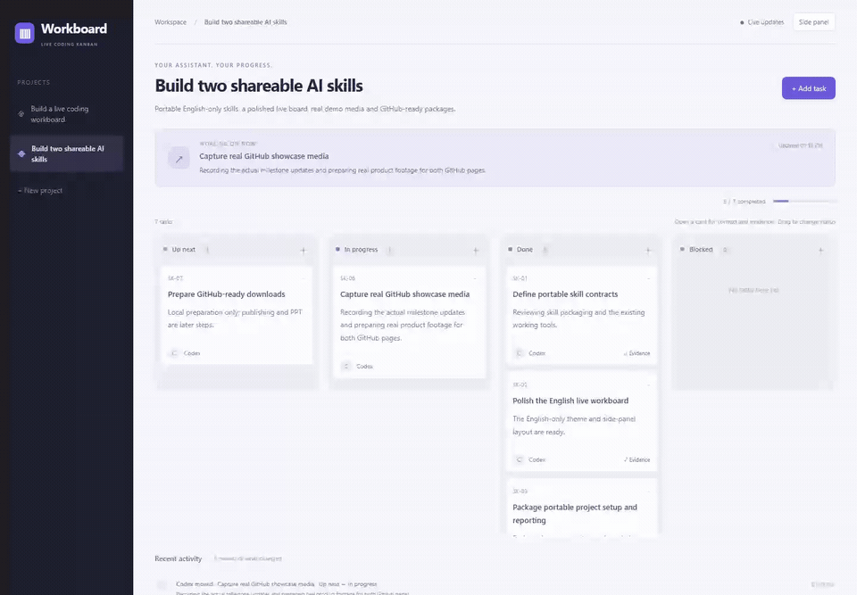

# AI Coding Kanban

**See what your coding assistant has done, what it is working on, and what comes next.**

A portable skill that puts a live, English-only Kanban beside your coding agent. The agent keeps coding and updates the board at meaningful milestones. Tasks, ownership, evidence and history survive handoffs between assistants.



[Watch the real screen recording](docs/media/live-board.mp4) · [View the full board](docs/media/board-overview.png) · [Read the skill](SKILL.md)

The media shows this skill's actual development board receiving real command-line updates. It is a browser recording, not an AI-generated interface or timer-driven animation.

## Try it with your agent

Download or clone this repository, then give your coding agent this prompt:

> Read `SKILL.md` in this repository. Use it to show a live board beside my editor while implementing my task. Create the plan after understanding the project, keep the board updated during the work, and attach the actual checks when a task is done. Keep the board and cards in English.

Replace the path with wherever you saved this folder. The agent needs file access, permission to run local commands, and Node.js 22+. The board itself has no dependencies, no model API key and no paid service.

For agents that support native skills, install the whole folder through their supported skill workflow. Claude Code also supports a project folder at `.claude/skills/live-coding-kanban/`; see [its official skill documentation](https://code.claude.com/docs/en/skills). Codex users can follow [the official skill instructions](https://learn.chatgpt.com/docs/build-skills). Explicitly reading `SKILL.md` works without native discovery.

## What you get

| Feature | Behavior |
| --- | --- |
| Four task states | Up next, In progress, Done and Blocked |
| Live progress | Real updates appear without refreshing the page |
| Reviewable results | Each card can retain progress notes and verification evidence |
| Cross-agent handoffs | Reuse project/card IDs, change the owner, preserve the history |
| Human control | Add tasks, drag cards, edit details and review who changed them |
| Editing protection | A stale manual save cannot overwrite a newer assistant update |
| Side panel | A compact layout for working beside the editor |
| Project isolation | Each workspace gets its own runtime, data and available local port |


## Start manually

From this skill repository:

```sh
node scripts/setup.mjs --workspace "/path/to/your/project" --project "feature-a" --title "Improve settings" --goal "Make profile settings easier to use" --owner "Codex"
```

The command prints the viewer URL and reporting tool path. Open that URL beside your editor. If another project occupies the preferred port, setup chooses a free one. It never stops that other project.

Setup adds scoped rules to `AGENTS.md`, `CLAUDE.md` and `WORKBOARD.md`, preserving existing content and backing up changed files. Use `--no-connect` for a one-session board. Runtime data stays in `.agent-workboard/` and is excluded from Git.

From the connected project, report real work:

```sh
node .agent-workboard/board.mjs task --project feature-a --id inspect --title "Inspect current settings" --status doing --note "Checking the save flow" --actor Codex
node .agent-workboard/board.mjs task --project feature-a --id inspect --status done --evidence "Started the app and saved a test profile successfully" --actor Codex
```

The next assistant can continue the same card IDs using `--actor "Claude Code" --owner "Claude Code"`. Read [the command reference](references/commands.md) for JSON batches and handoffs.

Resume: `node .agent-workboard/manage.mjs start`. Stop: `node .agent-workboard/manage.mjs stop`. Saved tasks remain.

## Compatibility and honest limits

The reporting interface is agent-independent: any coding agent that can read the instructions and run local commands can use it. Codex and Claude Code instruction files are provided; other agents can read `WORKBOARD.md` or the skill directly. Cloud executors need an available preview or port-forwarding mechanism; their loopback address is not automatically accessible on your computer.

The board relies on the assistant reporting progress. It is not an official vendor status API, does not read private reasoning, and does not independently prove the evidence an agent writes. A connected viewer means the board service is reachable, not that a model is generating.

Verified here: real Codex updates, an independent Codex implementation using this skill in a clean workspace, task persistence, live events, concurrent writers, occupied-port handling, safe stop/resume, manual editing conflicts, and responsive browser interactions. Claude Code instructions are included; a Claude Code process has not been run in this validation. See [validation notes](docs/validation.md).

## Development

```sh
node --test scripts/check.mjs
```

No install or build step is required for the board. Skill code is MIT licensed.
