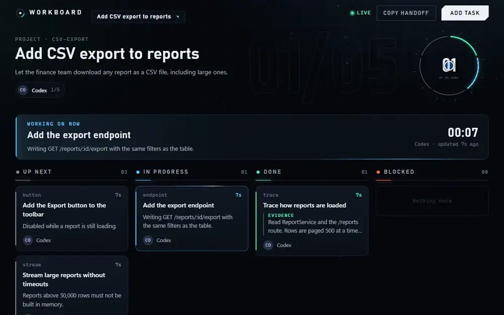
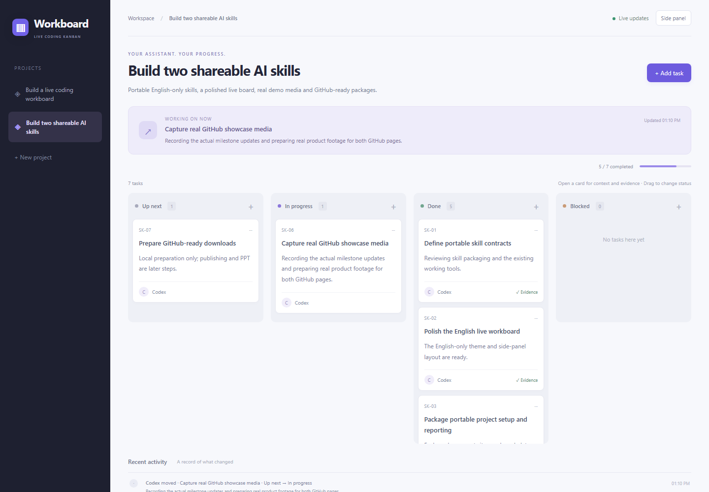

# AI Coding Kanban

**See what your coding assistant has done, what it is working on, and what comes next.**

A portable skill that puts a live board beside your coding agent. The agent keeps coding and reports at real milestones; cards move on screen the moment it does. Tasks, owners, evidence and history survive handoffs between assistants.



**The 38-second walkthrough, with narration:**

https://github.com/user-attachments/assets/2f67fc1a-d679-49e8-bcb6-358ed62166f5

[Download the MP4](docs/media/live-board.mp4?raw=true) · [Full board](docs/media/board-overview.png) · [Side-panel layout](docs/media/side-panel.png) · [Read the skill](SKILL.md)

Both are browser recordings of the real viewer. The plan they show (CSV export for a reports page) is a fictional sample; every change you see is a real `board.mjs` command sent to the running board during capture. Nothing is animated on a timer. The narration is a synthetic voice.

## Try it with your agent

Download or clone this repository, then give your coding agent this prompt:

> Read `SKILL.md` in this repository. Use it to show a live board beside my editor while implementing my task. Create the plan after understanding the project, keep the board updated during the work, and attach the actual checks when a task is done. Keep the board and cards in English.

Replace the path with wherever you saved this folder. The agent needs file access, permission to run local commands, and Node.js 22+. The board has no dependencies, no build step, no model API key and no paid service.

For agents that support native skills, install the whole folder through their supported skill workflow. Claude Code also supports a project folder at `.claude/skills/live-coding-kanban/`; see [its skill documentation](https://code.claude.com/docs/en/skills). Codex users can follow [the official skill instructions](https://learn.chatgpt.com/docs/build-skills). Explicitly reading `SKILL.md` works without native discovery.

## What you get

| Feature | Behavior |
| --- | --- |
| Four columns | Up next, In progress, Done and Blocked |
| Live motion | A card flies to its new column when the agent reports. No refresh, no polling by the page |
| Scrolling columns | Each column scrolls in its own box, four to five cards tall, so a long Done list never pushes the activity off the page. Finished work is listed newest first |
| Progress ring | One arc per card, in plan order. Click an arc to open that card |
| Time in status | Every card and the focus strip show how long the work has been in its current state |
| Evidence on the card | Done cards show their verification text. A card marked done without evidence says so |
| Handoff summary | `Copy handoff`, or `board.mjs summary`, produces Markdown for the next assistant or a pull request |
| Cross-agent handoffs | Reuse project and card IDs, change the owner, keep the history. Click an owner to highlight their cards |
| Human control | Add tasks, drag cards, edit title, owner, progress and evidence |
| Editing protection | A stale manual save cannot overwrite a newer assistant update; the open card warns you |
| Side panel | Below 860 px the board becomes one column with active work first |
| Tab status | The browser tab shows `done/total` and turns into a warning when a card is blocked |
| English and Chinese | A toggle in the bar switches the viewer's own wording and the card text together, and remembers the choice; it starts in Chinese for a Chinese browser. Boards are bilingual by default: the assistant writes every card in both languages, and the tool flags a card that is missing its Chinese copy (`--languages en` for an English-only board) |
| Archive finished work | `board.mjs archive --project X` takes a project out of the lists and keeps its cards, history and handoff. `unarchive` puts it back. Nothing is deleted |
| Idle boards stop themselves | With no viewer attached and no writes for four hours, the server exits and frees its ~110 MB. `manage.mjs start` brings it back from the file on disk. `BOARD_IDLE_MINUTES=0` keeps it running |
| Project isolation | Each workspace gets its own runtime, data and free local port |
| Jump between boards | The project list also shows the boards running for your other workspaces, as `port · project`. Selecting one opens it. Discovery is a loopback probe of the ports this skill hands out; nothing is shared or stored |



Motion is off under the operating system's reduced-motion setting, and the ambient background pauses in a hidden tab.

## Start manually

From this skill repository:

```sh
node scripts/setup.mjs --workspace "/path/to/your/project" --project "feature-a" --title "Improve settings" --goal "Make profile settings easier to use" --owner "Codex"
```

The command prints the viewer URL and the reporting tool path. Open that URL beside your editor. If another program occupies the preferred port, setup chooses a free one. It never stops that other program.

Setup adds scoped rules to `AGENTS.md`, `CLAUDE.md` and `WORKBOARD.md`, preserving existing content and backing up changed files. Use `--no-connect` for a one-session board. Runtime data stays in `.agent-workboard/` and is excluded from Git.

From the connected project, report real work:

```sh
node .agent-workboard/board.mjs task --project feature-a --id inspect --title "Inspect current settings" --status doing --note "Checking the save flow" --actor Codex
node .agent-workboard/board.mjs task --project feature-a --id inspect --status done --evidence "Started the app and saved a test profile successfully" --actor Codex
node .agent-workboard/board.mjs summary --project feature-a
```

The next assistant reads the summary, then continues the same card IDs with `--actor "Claude Code" --owner "Claude Code"`. Read [the command reference](references/commands.md) for JSON batches and handoffs.

Resume after a restart: `node .agent-workboard/manage.mjs start`. Stop: `node .agent-workboard/manage.mjs stop`. Saved tasks remain.

Upgrading from 1.x: run `setup.mjs` again with the same workspace and project. Cards and history are kept, and only this workspace's own viewer is restarted.

## Compatibility and honest limits

The reporting interface is agent-independent: any coding agent that can read the instructions and run local commands can use it. Cloud executors need a preview or port-forwarding mechanism; their loopback address is not automatically reachable from your computer.

The board relies on the assistant reporting progress. It is not a vendor status API, does not read private reasoning, and does not independently prove the evidence an agent writes. `LIVE` means the board service is reachable, not that a model is generating.

Verified here:

- **Codex** built 1.0 while maintaining its own board, and a second Codex agent used the skill in a clean workspace.
- **Claude Code** followed `SKILL.md` on a clean workspace, kept a six-card board through the 2.0 redesign, upgraded that board in place from 1.0.0 to 2.0.0 and resumed it after a reboot.
- Automated checks cover task lifecycle, time in status, the handoff summary, concurrent writers, live events, occupied ports, upgrade restarts and safe stop/resume.

Not run: a separate Claude Code process discovering the skill from `.claude/skills/`, other vendors' agents, macOS and Linux. See [validation notes](docs/validation.md).

## Development

```sh
node --test scripts/check.mjs
```

No install or build step is required. The viewer is five static files in `assets/workboard/public/`. Skill code is MIT licensed.
